# Cuatro Cortes: propuesta de *juice* y *game feel*

Rama `claude/vfx-juice-8cf288`, Godot 4.7.2.
Las capturas y GIFs de esta carpeta salen de la demo automática
`scripts/fx/dev/juice_showcase.tscn` (ver «Cómo reproducir»).

## 1. Criterio

Cuatro Cortes es un juego de gestión pausado, narrativo y de ambientación
barroca: el jugador **lee** mucho (rumores, cartas del Rey, sermones de la
monja) y **decide** con calma. Por eso el juice debe ser:

- **Material, no arcade.** Lacre, tinta, polvo de pergamino, oro, campanas. Nada
  de neones, números gigantes ni explosiones.
- **Breve.** Ninguna animación pasa de ~1 s, salvo los ambientes de las
  pantallas finales.
- **Proporcionado.** Lo frecuente (pasar un día, pequeñas variaciones de
  influencia) es casi imperceptible. Lo raro e importante (el Rey se enfada, se
  pierde la partida) se nota más, y aun así es sutil.
- **Informativo.** Cada efecto dice algo: que algo nuevo ha aparecido, que
  algo urge, que salió bien o mal, hacia dónde se ha movido una barra.

### Reglas obligatorias

1. **Accesibilidad: reducir movimiento.** `Juice.reduce_motion` (tecla **F10**,
   se guarda en `user://juice.cfg`; en la web se activa por defecto si el
   navegador declara `prefers-reduced-motion`). Con él activado no hay temblor
   de pantalla ni escalados o desplazamientos: los pops pasan a ser destellos de
   color, las entradas pasan a ser fundidos, la viñeta deja de latir, no hay
   ondas de tinta en el mapa, el grano queda estático y las partículas se
   reducen al 60 % y van más lentas. `Juice.enabled = false`
   apaga todo el juice (visual y sonoro) sin tocar el juego.
2. **No tapar textos largos.** El temblor solo mueve el *mundo* (mapa y
   edificios); la interfaz (ventanas, barras, la monja) nunca tiembla. La
   viñeta del Descontento se dibuja bajo la interfaz. Las ráfagas sobre
   ventanas duran menos de 1 s y salen del rótulo del resultado, no del texto.
   La monja entra con un fundido, sin máquina de escribir: el mismo clic que
   la cierra no puede hacer perder el texto.
3. **Respetar las pausas.** Los efectos van unidos a eventos del modelo
   (señales), así que mientras `TimeManager` está en pausa no hay efectos
   nuevos de la partida (no caducan lacres ni pasan días). El brillo de los
   lacres resueltos se detiene mientras haya pausa. Los tweens de interfaz
   (hover, ventanas) sí funcionan en pausa, porque responden al jugador.
4. **Calidad antes que rendimiento web** (corrección del director: se quita la
   restricción a WebGL2). Se usan `GPUParticles2D` con `ParticleProcessMaterial`
   (turbulencia, estelas, mezcla aditiva), un **postprocesado del mundo** con
   `hint_screen_texture` (ondas de tinta, gradación de color, viñeta y grano) y
   una **transición de mancha de tinta** con ruido fbm. Se probó también el
   *glow* HDR 2D (`WorldEnvironment` + `use_hdr_2d`) y se descartó porque
   lavaba los colores de las barras de la interfaz. Todo sigue ejecutándose
   también con `gl_compatibility`. Cero assets externos: los sonidos y las
   texturas se sintetizan (ver `assets/vfx/CREDITS.md`).
5. **Desacoplado.** Toda la lógica está en `scripts/fx/`. El juego solo tiene
   **una línea nueva** (`Juice.attach_main(self)` en `main.gd`) y un autoload.

## 2. Propuesta por momento

Leyenda. **Estado**: ✅ implementado en el prototipo · 🔸 propuesto.
**Coste**: S (< 1 h), M (medio día), L (1 día o más).
**Prioridad**: I = imprescindible, R = recomendable, O = opcional.

### 2.1 Aparece un rumor (lacre en el mapa)

| Efecto | Intensidad | Técnica | Coste | Prioridad | Estado |
|---|---|---|---|---|---|
| El lacre cae desde 1,8× con transparencia y se asienta con rebote (`TRANS_BACK`) | media | `Tween` sobre scale/self_modulate, compensando la posición porque el botón está a escala 0,12 | S | I | ✅ |
| Polvo sepia al tocar el mapa + golpe sordo de sello | baja | `GPUParticles2D` «dust» (turbulencia) + `seal` sintetizado | S | I | ✅ |
| Onda de tinta suave que deforma el mapa alrededor del lacre | baja | `Juice.ripple()` → `map_post.gdshader` | S | R | ✅ |
| Si aparecen varios el mismo día, escalonar 0,15 s | baja | `Tween` con `set_delay` | S | O | 🔸 |

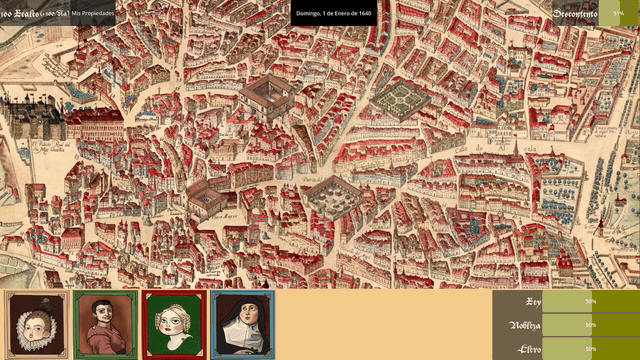

### 2.2 Pasa a aviso y caduca

| Efecto | Intensidad | Técnica | Coste | Prioridad | Estado |
|---|---|---|---|---|---|
| Aviso: el lacre late como un corazón (además del parpadeo que ya existía) | media | `Tween` en bucle sobre la escala; con movimiento reducido, latido de color | S | I | ✅ |
| Aviso: roce de papel grave | baja | `paper` con pitch 0,8 | S | R | ✅ |
| Caduca: el lacre se resquebraja (esquirlas de cera que caen) + crujido + temblor mínimo del mapa | media | `GPUParticles2D` «wax» con gravedad y rotación, `crack`, `shake(0.18)` | S | I | ✅ |
| Caduca: mancha de cera que queda en el mapa y se desvanece en 3 s | baja | `Sprite2D` + `Tween` | S | O | 🔸 |
| Cuenta atrás visual (anillo que se vacía alrededor del lacre) | media | shader de arco o `TextureProgressBar` | M | R | 🔸 (cambia el layout del botón: coordinar con ui-redesign) |

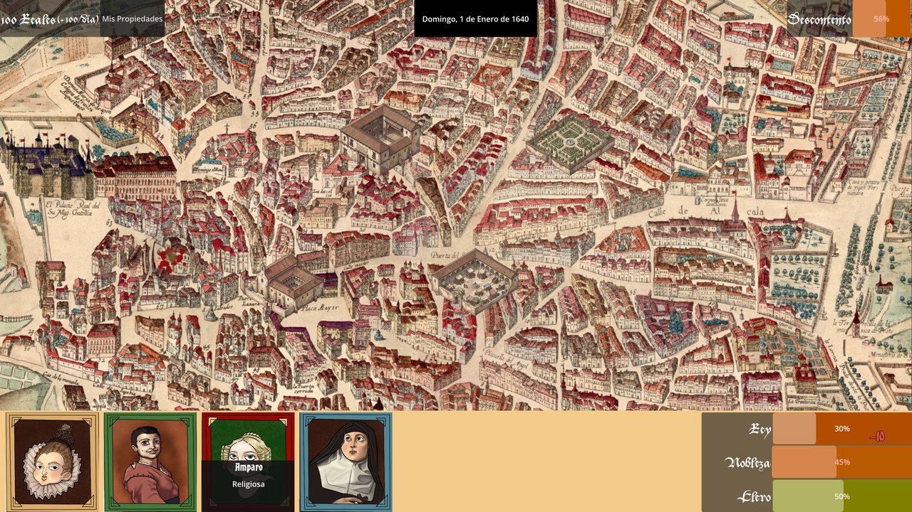

### 2.3 Arrastrar un agente y soltarlo en un hueco

| Efecto | Intensidad | Técnica | Coste | Prioridad | Estado |
|---|---|---|---|---|---|
| Al soltar: el retrato se aplasta como un sello (*squash & stretch*) + polvo + toque seco | media | `squash()` sobre el `AgentSelector`, detectado con `Mission.agents_changed` | S | I | ✅ |
| Al quitar un agente: soplo de polvo y roce de papel | baja | ídem | S | R | ✅ |
| Al empezar a arrastrar: el retrato se inclina 4° y sube su sombra; sonido de tela | baja | requiere tocar `Agent._get_drag_data` (una línea: `Juice.pop(self)`) | S | R | 🔸 |
| Hueco válido bajo el cursor: borde dorado que respira | baja | `can_drop_data` → `flash` (una línea en `agent_slot.gd`) | S | R | 🔸 |
| Agente no disponible al intentar arrastrar: sacudida horizontal «no» | baja | `Tween` de posición | S | O | 🔸 |

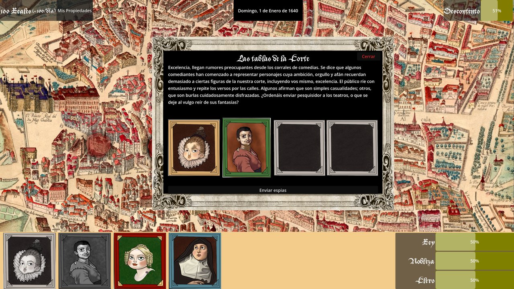

### 2.4 Enviar la misión

| Efecto | Intensidad | Técnica | Coste | Prioridad | Estado |
|---|---|---|---|---|---|
| El lacre pasa a azul con un golpe de sello: *squash*, anillo de tinta y golpe | media | `squash()` + `GPUParticles2D` «stamp» + `seal` | S | I | ✅ |
| La onda del sello recorre el mapa | baja | `ripple()` (postprocesado) | S | R | ✅ |
| Botón «Enviar»: hover y pulsación (como todos los botones) | baja | hover/pulsación global | S | I | ✅ |
| Los retratos «viajan» desde la ventana hasta el lacre | media | `Tween` de copias de los `TextureRect` | M | O | 🔸 |

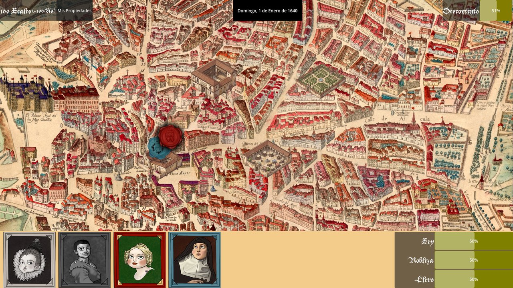

### 2.5 Misión en curso

| Efecto | Intensidad | Técnica | Coste | Prioridad | Estado |
|---|---|---|---|---|---|
| Ya existe: parpadeo lento azul (`AnimationPlayer`) | — | — | — | — | (existente) |
| Huellas o pequeño rastro de tinta que avanza alrededor del lacre | baja | `GPUParticles2D` continuo y local | S | O | 🔸 |

### 2.6 Éxito o fracaso al abrir el lacre

| Efecto | Intensidad | Técnica | Coste | Prioridad | Estado |
|---|---|---|---|---|---|
| Al resolverse: el lacre da un pop y suelta un destello; luego brilla cada 1,8 s para invitar a abrirlo (se detiene en pausa) | baja | `pop()` + «glint» con `Timer` | S | I | ✅ |
| La ventana entra con un fundido y un leve escalado (0,96 → 1) | baja | `window_in()` en `visibility_changed` | S | I | ✅ |
| **Éxito**: destellos dorados con estela y mezcla aditiva que salen del rótulo del resultado + campanilla + pop del rótulo | media | «gold» (`GPUParticles2D`, trails, turbulencia) + `chime` | S | I | ✅ |
| **Fracaso**: la tinta se derrama + esquirlas de cera + golpe sordo + temblor mínimo del mapa + el mapa pierde color un instante + aplastamiento del rótulo | media | «ink» + «wax» + `thud` + `shake(0.15)` + `grade_pulse()` | S | I | ✅ |
| Animación de lacre partiéndose en dos mitades al abrir | alta | 2 sprites + `AnimationPlayer` (requiere arte) | L | O | 🔸 |

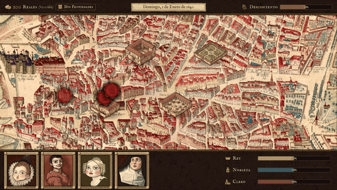 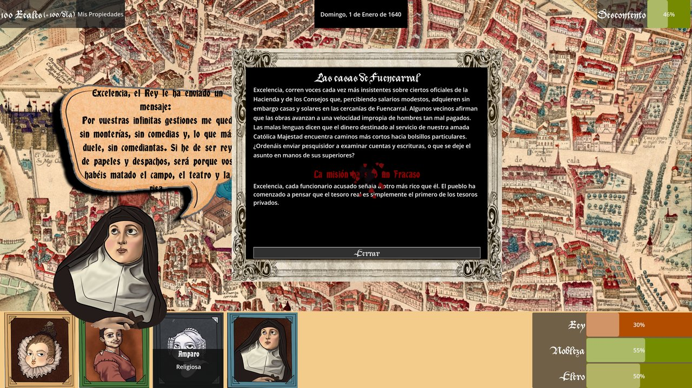

### 2.7 Barras de Rey, Iglesia, Nobleza y Descontento

| Efecto | Intensidad | Técnica | Coste | Prioridad | Estado |
|---|---|---|---|---|---|
| Destello de la barra al cambiar: dorado si es favorable, carmesí si no (en el Descontento, bajar es favorable) | baja | `flash()` con self_modulate > 1 | S | I | ✅ |
| Número flotante «+5» / «−10» que sube y se desvanece (solo si \|Δ\| ≥ 2, para no saturar con el +1 diario) | baja | `Label` + `Tween` | S | I | ✅ |
| Pop de la barra si \|Δ\| ≥ 10 | baja | `pop()` | S | R | ✅ |
| Zona de peligro (< 20): la barra late en rojo mientras siga ahí | media | `Tween` en bucle sobre `modulate` | S | I | ✅ |
| Barra que se llena de forma animada en vez de saltar | baja | `Tween` sobre `value`; requiere cambiar `update_*` en `main.gd` (lógica de color incluida) | S | R | 🔸 (coordinar con ui-redesign) |
| «Barra fantasma» (la parte perdida queda un instante en rojo) | baja | segunda `ProgressBar` detrás | M | O | 🔸 |

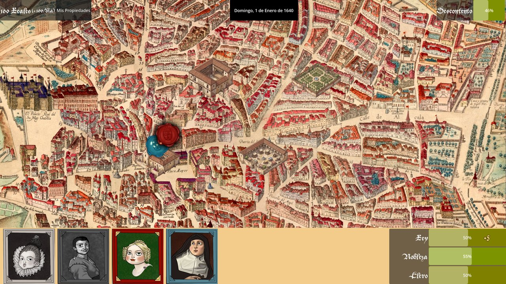 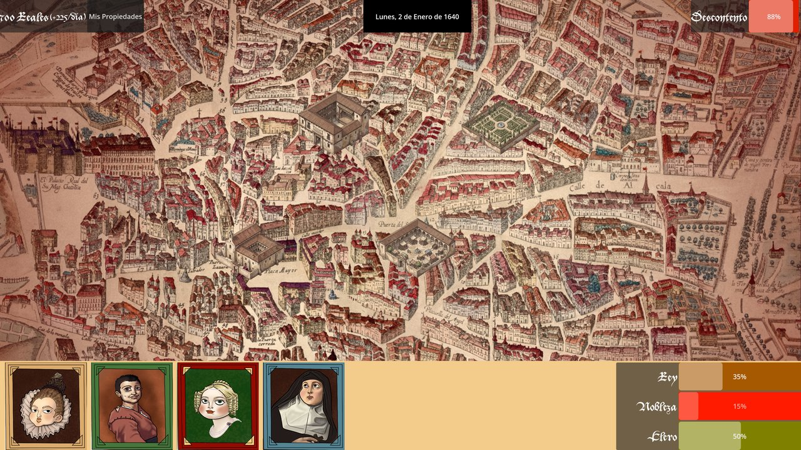

### 2.8 Cruzar umbrales de aviso (40 / 20 / 10) y mensaje de la monja

| Efecto | Intensidad | Técnica | Coste | Prioridad | Estado |
|---|---|---|---|---|---|
| **El Rey se enfada**: temblor sutil del mapa (crece con el nivel), golpe sordo y velo rojo en los bordes | media-alta | `shake(0.25 + 0.15·nivel)`, `thud`, `vignette_flash` (shader) | S | I | ✅ |
| **La Iglesia**: campana grave y velo morado | media | `toll` + `vignette_flash` | S | I | ✅ |
| **La Nobleza**: portazo y velo azul oscuro | media | `thud` + `vignette_flash` | S | I | ✅ |
| Destello carmesí en la barra que ha cruzado | baja | `flash()` | S | I | ✅ |
| El mundo se apaga: desaturación y sepia del mapa que se recuperan en 1,6 s + onda de tinta desde el centro | media | `grade_pulse()` + `ripple()` (postprocesado) | S | R | ✅ |
| La monja entra deslizándose y el bocadillo sube con un fundido + roce de papel | baja | `fade_in()` con offset; sin desplazamiento si se reduce el movimiento | S | I | ✅ |
| Sello del remitente (corona, cruz, escudo) en el bocadillo | baja | `TextureRect` + `pop()`; requiere arte | M | R | 🔸 |

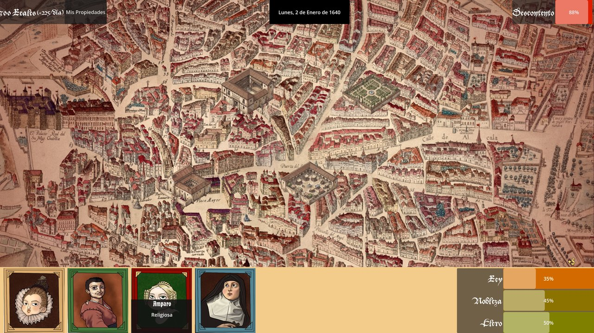 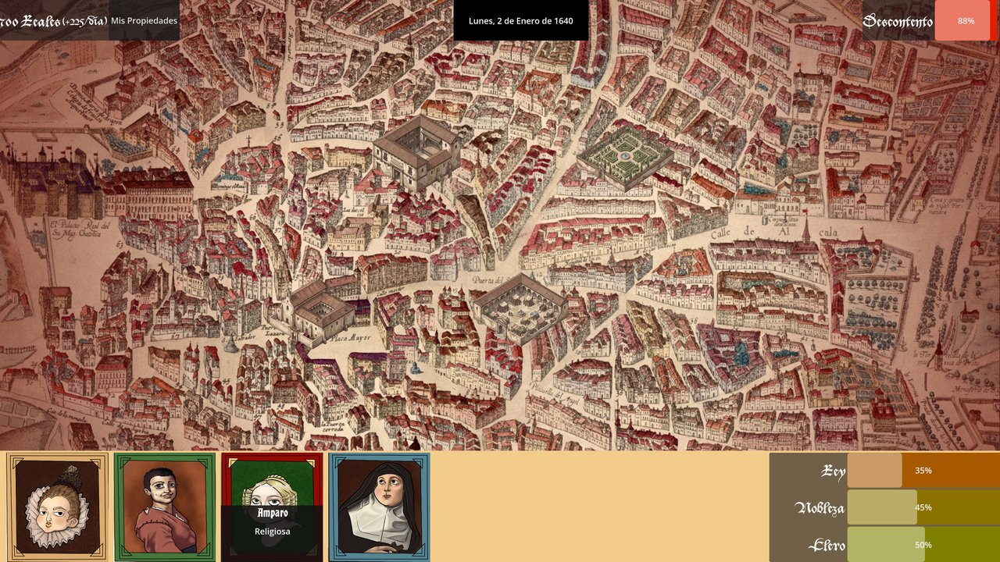 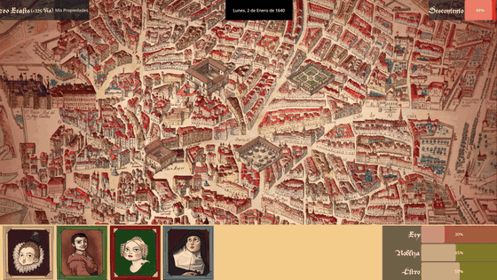

### 2.9 Descontento alto

| Efecto | Intensidad | Técnica | Coste | Prioridad | Estado |
|---|---|---|---|---|---|
| Viñeta rojiza en los bordes del mapa que crece a partir de 60 y late lentamente (sin latido si se reduce el movimiento). Va **bajo la interfaz** | proporcional | `map_post.gdshader` (uniforms `tint`, `intensity`, `pulse`) | S | I | ✅ |
| Madrid se apaga: el mapa pierde color y vira a sepia en proporción al Descontento | proporcional | `set_base_grade()` (postprocesado) | S | R | ✅ |
| Grano de papel muy sutil y animado (estático si se reduce el movimiento) | muy baja | `map_post.gdshader` | S | O | ✅ |
| Se mantiene el audio `furiosos.mp3` que ya existe | — | — | — | — | (existente) |
| Humo o antorchas en los barrios con Descontento > 85 | media | `GPUParticles2D` local | M | O | 🔸 |

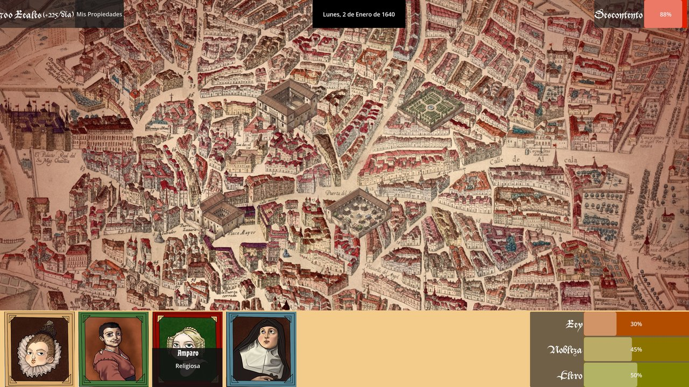

### 2.10 Edificios: compra, donación y renta diaria

| Efecto | Intensidad | Técnica | Coste | Prioridad | Estado |
|---|---|---|---|---|---|
| **Compra**: el edificio se aplasta como un sello, destellos dorados, anillo de tinta, golpe de sello + campanilla tenue | media | detectado comparando `Building.owner` tras cada cambio de riqueza | S | I | ✅ |
| **Donación**: pop del edificio, brillo, polvo y campana | media | ídem (`owner` → FACTION) | S | R | ✅ |
| **Renta diaria**: monedas que saltan del contador, «+N» dorado, tintineo y pop del número | baja | «coins» + `coin` | S | I | ✅ |
| **Gasto**: «−N» carmesí y tintineo grave | baja | `float_text` + `coin` con pitch 0,75 | S | R | ✅ |
| Contador que cuenta hacia arriba en vez de saltar | baja | `Tween` sobre un valor mostrado; requiere tocar `update_riqueza` | S | O | 🔸 |

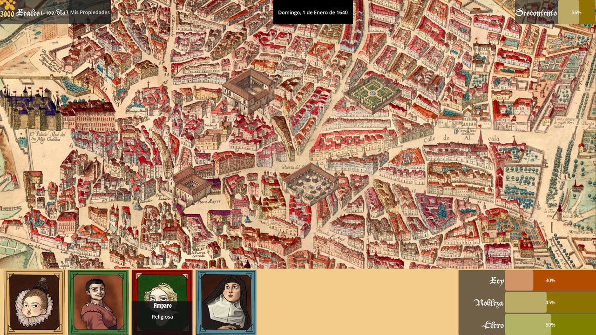 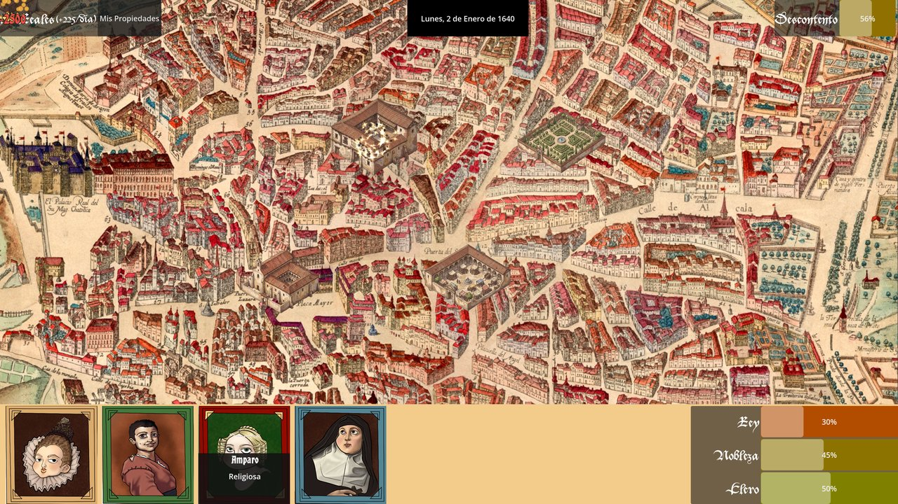

### 2.11 El paso de los días

| Efecto | Intensidad | Técnica | Coste | Prioridad | Estado |
|---|---|---|---|---|---|
| Se pasa la página del calendario: la fecha se funde suavemente | muy baja | `Tween` sobre `self_modulate:a` | S | R | ✅ |
| Los domingos suena una campana lejana de Madrid | muy baja | `bell` a −16 dB | S | O | ✅ |
| Luz del mapa según la hora (amanecer y atardecer) | baja | `CanvasModulate` + `Tween` | M | O | 🔸 |

### 2.12 Victoria y derrota

| Efecto | Intensidad | Técnica | Coste | Prioridad | Estado |
|---|---|---|---|---|---|
| Al cambiar de escena, una mancha de tinta que se retira desde el centro con bordes irregulares y quemados (en lugar del corte seco) | media | `ink_transition.gdshader` (ruido fbm) + `Tween` | S | I | ✅ |
| **Derrota**: campana grave y ceniza que cae detrás del soneto | media | `GPUParticles2D` ambiente «ash», insertado detrás del texto | S | R | ✅ |
| **Victoria**: campanilla y motas doradas que flotan detrás del soneto | media | ambiente «motes» | S | R | ✅ |
| Fundido de salida (antes del cambio) | baja | requiere que `GameManager._change_scene_to_file` espere a un `await Juice.fade_out()` | S | R | 🔸 (toca GameManager) |

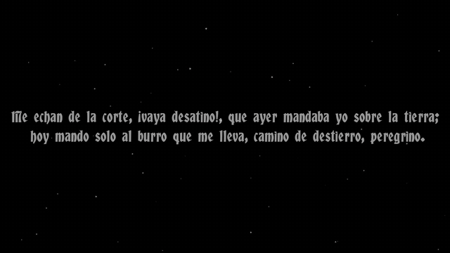

### 2.13 Botones del menú y de la interfaz

| Efecto | Intensidad | Técnica | Coste | Prioridad | Estado |
|---|---|---|---|---|---|
| Hover: escala 1,05 desde el centro; pulsación: 0,94 con rebote; clic casi inaudible | baja | `SceneTree.node_added` → todos los `BaseButton` (se excluye uno con `set_meta("juice_ignore", true)`) | S | I | ✅ |
| Con movimiento reducido: hover con un leve aclarado del color | baja | `self_modulate` | S | I | ✅ |
| Menú: brillo dorado que recorre el título cada pocos segundos | baja | shader de *sheen* | S | O | 🔸 |

### 2.14 Descartado a propósito

- **Hit-stop / congelar el tiempo**: no encaja en un juego pausado; las pausas
  ya las marcan las ventanas.
- **Temblor en la interfaz**: perjudica la lectura.
- **Máquina de escribir en la monja**: el clic que la cierra haría perder el
  texto (ver regla 2).

## 3. Implementación (prototipo)

### Ficheros nuevos

| Fichero | Qué es |
|---|---|
| `scripts/fx/juice.gd` | Autoload `Juice`: API, ajustes, capas propias (FX y overlay), hover de botones, transiciones y ambientes |
| `scripts/fx/main_juice.gd` | Feedback de la partida; lo crea `Juice.attach_main()` |
| `scripts/fx/juice_sfx.gd` | `JuiceSfx`: síntesis de sonidos (o el fichero de `assets/vfx/sfx/` si existe) |
| `scripts/fx/juice_particles.gd` | `JuiceParticles`: ráfagas y ambientes `GPUParticles2D` con texturas procedurales |
| `scripts/fx/map_post.gdshader` | Postprocesado del mundo: ondas de tinta, desaturación/sepia, viñeta de Descontento y grano |
| `scripts/fx/ink_transition.gdshader` | Transición de mancha de tinta entre escenas |
| `scripts/fx/vignette.gdshader` | Velo de bordes de los umbrales (capa superior) |
| `scripts/fx/dev/juice_showcase*.{tscn,gd}` | Demo automática para revisar y capturar (no forma parte del juego) |
| `docs/.gdignore` | Evita que Godot importe y exporte las capturas |
| `assets/vfx/CREDITS.md` | Recursos y licencias |

### API de `Juice`

```gdscript
Juice.shake(0.3)                       # temblor del mundo, 0..1, acumulativo
Juice.pop(node, 0.15)                  # pop de escala con rebote
Juice.squash(node)                     # squash & stretch (sello)
Juice.drop_in(node)                    # aparición que cae y se asienta
Juice.pulse_loop(node, true)           # latido continuo (false lo detiene)
Juice.flash(node, Color(1.6, 1.4, .9)) # destello de color
Juice.fade_in(node, 0.3, Vector2(0, 14))
Juice.window_in(panel)
Juice.burst(Juice.screen_center(node), &"gold")   # dust, wax, ink, gold, coins, glint, stamp
Juice.float_text(pos, "+5", Color.GOLD)
Juice.sfx(&"bell", -6.0)               # seal, crack, paper, coin, click, thud, chime, bell, toll
Juice.vignette_flash(Color(.45, .02, .02))
Juice.ripple(screen_pos, 1.0)          # onda de tinta en el mapa (postprocesado)
Juice.grade_pulse(0.6, 0.4, 1.2)       # el mapa pierde color y se recupera
Juice.set_base_grade(desat, sepia)     # gradación de fondo (Descontento)
Juice.reduce_motion = true             # o set_reduce_motion(); F10 lo alterna
Juice.enabled = false                  # apaga todo el juice
```

Los escalados funcionan en nodos con escala base distinta de 1 (el lacre está
a 0,12) sin tocar `pivot_offset`: se compensa la posición y, al final, se
restauran exactamente la posición y la escala originales, así que no se pelean
con el `AnimationPlayer` del lacre (que anima `modulate`; el juice usa
`self_modulate`).

### Puntos de enganche en el código existente

| Fichero | Cambio | Para qué |
|---|---|---|
| `project.godot` | `+ Juice="*res://scripts/fx/juice.gd"` al final de `[autoload]` | registrar el autoload |
| `scenes/play_scenes/main.gd` | `+ Juice.attach_main(self)` al final de `_ready()` | crear `MainJuice` como hijo de la escena |

**Ningún otro fichero existente se modifica.** `MainJuice` se engancha a:

| Momento | Señal o fuente existente | Lee de `main.gd` |
|---|---|---|
| Aparece, aviso, en curso, resuelta | `MissionManager.added_mission`, `warning_mission` (+ `mission.status`) | `buttons` |
| Caduca / cerrada | `MissionManager.clossed_mission` | — |
| Barras | `Player.rey_updated`, `nobleza_updated`, `clero_updated`, `descontentoy_updated` | `rey_bar`, `nobleza_bar`, `clero_bar`, `descontento_bar` |
| Umbrales | `Player.rey_strike`, `noble_strike`, `iglesia_strike` | — |
| Riqueza, compra, donación | `Player.riqueza_updated` + `BuildingManager.buildings[*].owner` | `riqueza_label`, `buildings_container`, `building_window` |
| Ventanas | `visibility_changed` de `mission_window`, `mission_resolution_window`, `building_window`, `properties_window` | ídem + `PanelContainer` hijo |
| Agentes en huecos | `Mission.agents_changed` de la misión abierta | `mission_window.agent_roast` |
| Monja | `visibility_changed` de `monja_speak/Label` | `monja_speak` |
| Días | `TimeManager.last_day` (sondeo en `_process`) | `time_label` |
| Transiciones y finales | `GameManager.scene_changed`, `game_started` | — |
| Botones | `SceneTree.node_added` (todo `BaseButton`) | — |

Si `ui-redesign` renombra alguna de esas variables `@onready` o nodos, el
efecto correspondiente deja de dispararse sin romper nada (todas las lecturas
son defensivas). Conviene mantener los nombres o avisar.

### Compatibilidad con los arreglos pendientes del checkout principal

- No se llama a `TimeManager.pause()`/`resume()`, así que el cambio a pausa por
  origen no afecta. Solo se lee `TimeManager.paused` y `last_day`, que siguen
  existiendo.
- La línea de `main.gd` va justo después de
  `properties_button.pressed.connect(...)`, que no cambia en esos arreglos, así
  que la fusión es limpia.
- Los sonidos salen por el bus «Efectos» que crea `ui-redesign` en
  `default_bus_layout.tres`; si no existe, por Master.
- El clamp nuevo de `Player` (0..100) no afecta: los deltas se calculan con el
  valor emitido.

### Textos

El único texto nuevo es el aviso de F10 («Movimiento reducido:
activado/desactivado»), envuelto en `tr()` para `localization`. Los números
flotantes no se traducen.

## 4. Cómo reproducir las capturas

```bash
# Demo con capturas JPG en docs/vfx/ (Forward+)
"/Applications/Godot 4.7.2.app/Contents/MacOS/Godot" --path . --resolution 1280x720 res://scripts/fx/dev/juice_showcase.tscn
# Con vídeo (Movie Maker) para sacar GIFs
"/Applications/Godot 4.7.2.app/Contents/MacOS/Godot" --path . --resolution 1280x720 --write-movie /tmp/juice.avi --fixed-fps 30 res://scripts/fx/dev/juice_showcase.tscn
# Comprobar el renderer de la web y el modo sin movimiento, sin capturas
"/Applications/Godot 4.7.2.app/Contents/MacOS/Godot" --path . --rendering-method gl_compatibility res://scripts/fx/dev/juice_showcase.tscn -- --reduce-motion --no-shots
```

La demo fuerza los estados (despliega misiones antes de tiempo, decide el
resultado, sube el Descontento…) llamando a la API pública de los managers.
Al terminar, el ajuste de reducir movimiento queda guardado en
`user://juice.cfg`; bórralo si molesta.

## 5. Pendiente / siguiente iteración

Por orden de impacto/coste:

1. Arrastre de agentes (inclinación + tela) y resalte del hueco válido: dos
   líneas en `Agent.gd` / `agent_slot.gd`.
2. Fundido de **salida** entre escenas: `await Juice.fade_out()` en
   `GameManager._change_scene_to_file`.
3. Barras y riqueza que se animan hasta el valor nuevo (tocar `update_*` en
   `main.gd`; mejor dentro del rediseño de UI).
4. Interruptor visible de «Reducir movimiento» en el menú/opciones
   (`Juice.set_reduce_motion(toggled)`): lo debería colocar `ui-redesign`.
5. Cuenta atrás visual en el lacre, sellos de remitente en la monja y lacre que
   se parte en dos: necesitan arte.
6. Sustituir la síntesis por grabaciones CC0 (Kenney RPG Audio) si se prefiere
   un sonido más orgánico: basta con dejar los ficheros en `assets/vfx/sfx/`.
7. *Glow* real: se descartó el HDR 2D global porque cambiaba el color de la
   interfaz. Si se quiere, la alternativa es un `SubViewport` solo para el
   mundo con HDR y glow, y la interfaz fuera de él.
